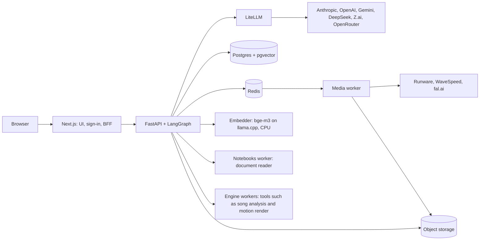
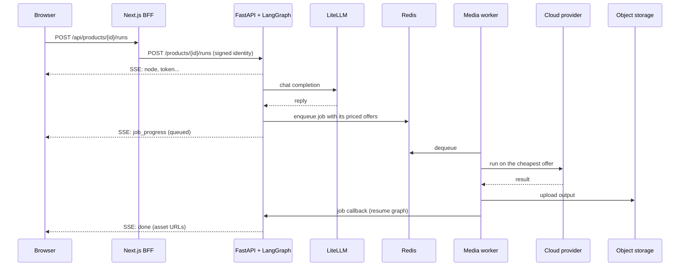

# Architecture

Status: current as of November 2026. Decisions referenced here are recorded in [`decisions/`](decisions/README.md).

## Goals

- Launch new AI products quickly by reusing one platform core.
- One engine for the desktop app and the web app ([ADR-0056](decisions/0056-desktop-app-and-web-share-one-engine.md)).
- Let each person choose where a model runs: on their computer, in the cloud on their own keys, or on a
  subscription they already pay for.
- Run identical container images for the web on a laptop (dev), a home lab k3s cluster (staging) and managed
  Kubernetes (prod).
- Keep every model swappable; build multi-tenancy and usage records in from the start.

## One engine, two profiles

The engine (`services/api`, FastAPI and LangGraph, with `packages/platform-sdk` and the products) runs under a
**deployment profile**. The profile swaps the services behind the same interfaces. Product code never asks which
profile it runs in ([desktop profile](desktop-profile.md)).

| | Desktop | Web |
|---|---|---|
| Shell | Tauri window; the engine on `127.0.0.1` with a token per launch | Next.js app; its route handlers sign a short-lived token and proxy to the API |
| Records, run state | SQLite | Postgres with pgvector |
| Job queue | `SqliteJobQueue`, a worker inside the engine | Redis streams and a separate media worker |
| Files | a folder; links signed by the engine | object storage (SeaweedFS, S3, GCS, Azure Blob); presigned links |
| Secrets | the system keychain (an encrypted file where there is none) | the `secrets` table, encrypted, per tenant |
| Models | local, your keys, or your subscription (below) | cloud only, on the keys an admin set |
| People | one person | many tenants and users, sign-in with Auth.js |

The screens live in `packages/ui` and talk to the engine through `packages/client`, so the window and the web app
draw the same screens.

## Where models run

There are three ways to reach a model. Each product chooses one in the model button
([ADR-0086](decisions/0086-one-simple-model-picker.md)).

### 1. Local (desktop)

The engine starts each program on demand and stops it when the engine ends. Each one is an optional part,
downloaded only after the person has seen its size.

| Work | Program |
|---|---|
| Chat, the assistant, Notebooks answers | llama.cpp (`llama-server`, with `--mmproj` to read pictures), or a model in Ollama or LM Studio |
| Images, video | ComfyUI, managed by the engine, with pinned workflows (FLUX.2 klein, Z-Image, LTX-Video, Wan 2.2 and others) |
| Speech, music, dubbing | audio.cpp (Kokoro, Parakeet, Whisper, ACE-Step) |
| Lip sync, 3D | MuseTalk; Pixal3D through pixal3d.cpp |
| Meetings | Sortformer and ERes2Net on ONNX Runtime |
| Training | AI Toolkit (pictures, video), mlx-lm (writing), PyTorch (decisions) |
| Documents | the notebooks' document reader, a separate process |

The engine also finds models that other tools have already downloaded
([ADR-0063](decisions/0063-self-sufficient-desktop-discovers-existing-models-and-tools.md)).

### 2. Cloud on the person's own keys (desktop and web)

[ADR-0100](decisions/0100-haiku-text-and-cheapest-media-provider.md):

- **Text** runs on Claude Haiku 5.5 by default, bought directly from Anthropic. The person can choose a model from
  Anthropic, OpenAI, Google Gemini, DeepSeek, Z.ai or OpenRouter, each with its own key.
- **Media** runs on Runware, WaveSpeed and fal.ai. Each media line in the catalogue (`own_keys_catalogue.py`) lists
  the providers that offer the model, with their prices.
  - At Make, the router (`wasifyai_platform_sdk/offers.py`) prices the job on every offer that has a key and can do
    what was asked, and runs the cheapest one.
  - It moves to the next offer only if the first is refused before it starts running, so a paid job is never sent
    twice.
  - Each job writes a `cloud.cost` usage event.
- **On the desktop**, the person adds the keys in the model button's Cloud tab.
- **On the web**, an admin adds the service's keys in Admin › Models (text) and Admin › Media (media). Text goes
  through LiteLLM. A media job carries the name its key is kept under, never the key itself, and the media worker
  (`COMFYUI_MODE=cloud`) runs it.

### 3. Cloud on the person's subscription (desktop, Code)

A coding session can run on the person's own Claude Code or Codex, signed in with their Claude or ChatGPT plan
([ADR-0107](decisions/0107-harnesses-the-persons-own-agent-program.md)).

- **How it is started:** through the ACP agent of the OpenHands Agent Server that the coding engine already runs.
- **Sign-in:** the program signs in through the provider's own page. Nothing of ours reads or keeps the login.
- **Sandbox:** the session gets a sandbox of its own kind, opened only to that provider's hosts and the program's
  sign-in files.
- **What stays the same:** the check loop, undo, Changes, Preview and Scheduled runs belong to the Wasify engine
  ([ADR-0103](decisions/0103-check-loop-and-undo-belong-to-the-wasify-engine.md)).

## The web deployment

The web has **no GPU and runs one model of its own**: bge-m3 for search, on the CPU. Everything else runs on cloud
models ([environments](environments.md)). Tools that are not models, such as reading documents, analysing songs and
rendering motion graphics, run on CPU workers ([ADR-0087](decisions/0087-engine-workers-run-the-desktops-capabilities-for-the-web.md)).

| Component | Responsibility | Scales on |
|---|---|---|
| Next.js app | UI. Its route handlers act as the BFF and proxy to the API; the browser never calls FastAPI directly | CPU, stateless |
| FastAPI + LangGraph | Runs product graphs, streams SSE, owns identity, tenant context, usage events and job callbacks | CPU, stateless |
| LiteLLM | One OpenAI-compatible gateway for every text and embedding call; model aliases (`model_defaults.yaml`) | CPU, stateless |
| Media worker | Takes Redis jobs and runs them on the cheapest keyed cloud offer, uploads the outputs and resumes the graph | Queue depth |
| Embedder | bge-m3 for search, served by llama.cpp | CPU |
| Notebooks worker | Reads the sources people add and makes Studio outputs | Queue depth |
| Postgres + pgvector | App data, LangGraph checkpoints, jobs, usage events, search vectors, encrypted keys | Managed in prod |
| Redis | Job queue; pub/sub of progress to any API replica | Managed in prod |
| Object storage | Uploads and everything made | Managed |

### Request flow

Key properties:

- **Graph state lives in the database**, so any API replica can resume any run. No sticky sessions are needed.
- **Progress fans out through Redis pub/sub**, so the replica holding a browser's SSE connection receives events
  produced anywhere.
- **Slow work is never awaited inline.** Nodes enqueue a job, and the graph resumes on its callback.
- **Outputs are URLs**, never bytes in the stream ([SSE contract](contracts/sse-events.md)).

## Platform core and products

A product is a folder under `products/` containing:

- `product.yaml`: the ID, its models and capability bindings, uploads and settings.
- `graphs/` and the product's own routes and store.
- `prompts/` and, for local media, `workflows/` (ComfyUI JSON with input and output maps).

Today there are ten products: assistant, image, video, voice, creative, notebooks, meetings, model3d, training and
code.

- **No new endpoints are needed to run a product.** The graph registry exposes registered graphs through the generic
  `/products/{product_id}/runs` routes (ADR-0003). A product may add authenticated routes for its own data (ADR-0023).
- **What a product can reach.** Its routes and graphs reach the engine's services through one typed `EngineServices`
  object (`wasifyai_platform_sdk.services`), built in `wasifyai_api/assemble.py`. A service this deployment does not
  have is `None`.
- **Product tables.** A product with tables of its own has one store class over `StoreDb`: a SQLite file on the
  desktop, or its own schema in Postgres on the web. The SQL is written once.
- **Capabilities, not models.** Graphs ask for capabilities (`text.chat`, `image.generate`, `video.generate`). The
  chosen model, and on the cloud its offers, decide what answers. Swapping a model is a configuration change
  ([configuration.md](configuration.md), ADR-0010, ADR-0097).

## Every feature is an action

Anything a person or an agent can ask the app to do is an action in one catalogue
([ADR-0068](decisions/0068-one-action-catalogue.md), [docs/actions.md](actions.md)). Each action has a help file and a
place in the menu. The executor runs actions for:

- the window;
- the assistant, which asks before it makes or changes something;
- other apps, through the MCP server ([desktop/connections.md](desktop/connections.md)).

`make contracts` writes the catalogue to `docs/contracts/actions.json`.

## Everything a user makes is searchable

My creations (ADR-0040) is one library with one search (ADR-0041): a per-user index of the words of everything a
person makes, with a multilingual embedding (`bge-m3`) and an exact-word check. **A new product or kind of creation is
not finished until it is indexed.** That means:

- text to index;
- `caps.index_creation` on save and `deps.unindex` on delete;
- a registered `IndexSource`;
- an `ids=` filter on its list route;
- a card in the library.

## Infrastructure (web)

1. **Infrastructure** is the only cloud-aware layer, with one OpenTofu module per target.
2. **Cluster add-ons** are the same everywhere: Gateway API, cert-manager, ExternalDNS, External Secrets, KEDA and
   Argo CD.
3. **The platform** is one Helm chart (`deploy/helm/wasifyai`), with values layered `base` → `env` (staging, prod) →
   `cloud` (homelab, aws, gcp, azure).

Monitoring uses Prometheus, Alertmanager, Grafana and Loki, with alerts to Telegram and an outside heartbeat
([ADR-0048](decisions/0048-monitoring-and-alerting.md), [runbook](runbooks/monitoring.md)).

## Seams for later features

| Feature | Seam built now |
|---|---|
| Multi-tenancy | `tenant_id` and `product_id` on every table, job and object key; keys per tenant |
| Auth | Identity resolved on every request. Auth.js in Next.js; the BFF signs a short-lived JWT that FastAPI checks (ADR-0030) |
| Billing | `usage_events`: tokens, jobs, and the cloud cost of each job, with its provider |
| Observability | OpenTelemetry, structured JSON logs with trace IDs, Langfuse for LLM traces |
| Limits | None per person in v1 (ADR-0094); one job per person across everything is decided, not built (ADR-0088) |

## Security baseline

- **Desktop engine.** It binds loopback only, and every route except `/health` needs the launch token.
- **Keys.** They are kept in the keychain or encrypted in the database. They are write-only through the API and are
  never sent inside a job.
- **Coding sessions.** They run in a sandbox. The model key stays outside it, behind a gateway on loopback
  ([ADR-0102](decisions/0102-coding-engine-optional-part-in-a-sandbox.md)).
- **Subscription sign-in.** It happens only through the provider's own program and page.
- **Local programs.** ComfyUI, llama.cpp and the other local programs have no authentication of their own; they bind
  to localhost only. ComfyUI custom nodes are pinned and reviewed.
- **Cloud and containers.** Workload identity per cloud, with no static cloud keys in pods; rootless containers
  locally.
