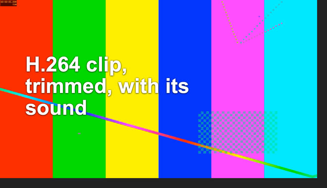
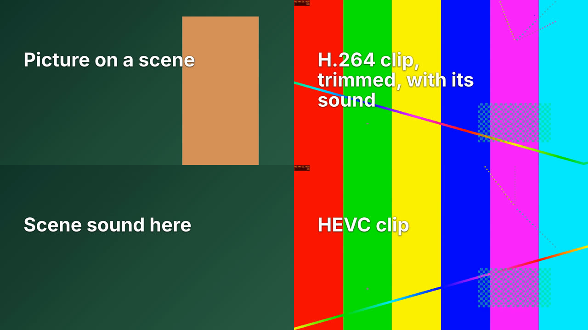

# Spike MX0: can Motion graphics become a scene editor? (2026-10-31)

**Asked by:** the owner, stage MX0 of `docs/motion-graphics-editor-plan.md`, ADR-0096.

**Machine:** the owner's MacBook Pro (Apple M5 Pro, 64 GB). The installed Motion graphics component: HyperFrames 0.8.171, its bundled
FFmpeg 4.4, the pinned browser. Nothing was downloaded. Throwaway scripts stayed outside the repo. Test media was made with FFmpeg
(colour bars and sine tones), so these numbers are about the machinery, not about how good a real promo looks.

**Verdict: go.** All four unknowns came out better than the plan feared. The live preview needs no new package and no Node process.

## 1. Live preview

| Check | Chromium (the browser pane) | WebKit (the engine of our window) |
|---|---|---|
| The player loads a multi-scene project of plain files | yes, duration 15 s | yes, duration 15 s |
| Seek to 6 s shows the right frame | yes | yes: the clip's own timecode says 00:00:05, frame 150, as in the render |
| Play for 3 s | moved 2.9 s | moved 2.5 s (includes the start) |
| Under our window's rules as they are today | not tested | **blocked**: never ready |
| With `frame-src http://127.0.0.1:*` added | not tested | works |
| Served with a token in the path, byte ranges and a tight policy | not tested | ready, seek works |

- **How it works.** KinoFold runs HyperFrames' Studio server for its preview. That is not needed. The `<hyperframes-player>` element in
  the package (`dist/hyperframes-player.global.js`, 110 KB) plays plain files, as long as the page also loads the package's
  `dist/hyperframe.runtime.iife.js`. So the engine only serves a folder of files, which works the same way on the desktop and on a web
  worker.
- **The WebKit check was not the real window.** It was a small Swift program with a `WKWebView`, a page on a custom `tauri://` scheme
  and our window's content rules, with the composition on `http://127.0.0.1`. The real window is checked in MX2.
- **An off-screen window does not play.** Play stayed at 1 s in an off-screen WebKit window and worked on screen. Seeking worked in both.
  The screen should not assume playback runs when the app is hidden.

## 2. Media in the sandbox

A 15 s, 1080p, four-scene project through the real sandbox (`run_render`), with nothing changed in it:

| Input | Result |
|---|---|
| A PNG placed on a scene | drawn |
| H.264 clip as the background, trimmed by 3 s | drawn; at 6 s in the film the clip's timecode says 00:00:05, which is right |
| That clip's own sound (440 Hz) | only during its scene, -21 dB |
| A sound on one scene (880 Hz) | only during its scene, -17 dB |
| Soundtrack at 40% (220 Hz) | in every scene, -26 dB, which is 40% of the source |
| **HEVC clip** | **drawn**, right timecode |
| Addresses blocked by the filter | none |

The render was 21 s, 2.41 GB, H.264 and stereo AAC, 15.000 s long. The project's files need no change for the sandbox as long as media
is copied into the project's folder. Our lint must keep skipping `vendor/`, so GSAP stays there.

## 3. Length and size

60 s, six scenes of 10 s, at 30 fps, through the sandbox, with the bundled FFmpeg 4.4. "With footage" has three H.264 clips, three
pictures and a soundtrack.

| Project | Render | Peak memory | File |
|---|---|---|---|
| Words only, 1920 x 1080 | 41 s | 3.04 GB | 2 MB |
| With footage, 1280 x 720 | 28 s | 4.13 GB | 21 MB |
| With footage, 1920 x 1080 | 48 s | 4.74 GB | 46 MB |
| With footage, 1080 x 1920 | 47 s | 4.79 GB | 23 MB |

- **Faster than real time at 1080p**, so several shapes from one project are cheap.
- **Memory is higher than we state.** `RENDER_NEED_GB` is 3.0 and a comment says "2 to 3 GB". Footage takes it to about 4.8 GB. The limit
  is half the machine's memory (3 to 8 GB), so a 16 GB Mac passes and an 8 GB machine would be stopped. MX5 raises the figure to 5.
- The words-only render is slower than the 720p render with footage, and I did not look into why.

## 4. The HyperFrames version

Everything above ran on our pinned 0.8.171. **No upgrade to 0.8.202 is needed for the player.** The player file must be available to the
window under `script-src 'self'`, so it is copied from the pinned package into the shared UI at build time.

## Other things found

- **Fonts differ between the preview and the export.** A page that asks for Arial got a different face in the render than in WebKit. The
  document must use only the fonts we ship, as the templates already do, or the preview will mislead.
- **The player's frame allows scripts and same-origin together.** On the desktop the composition is on another origin, so this is safe.
  On the web, a preview proxied on the app's own origin would not be isolated by the frame. The document only holds data and the HTML
  comes from our generator with text escaped; the response also gets the tight policy tested above. MX1 serves it on its own path, and a
  separate origin is considered for the web.
- **The window cannot send its token with a frame.** The engine asks for a bearer token in a header, and a frame's requests cannot carry
  one. So the preview route takes a short-lived signed token in its path, scoped to one project (CLAUDE.md rule 8 still holds: the
  token says who is asking). The web's proxy can use the session as it does today.
- **The engine route must serve byte ranges** for video seeking.

## Not measured

- The real Tauri window, and the web through its real proxy on a running stack (Chromium was tested from a plain loopback server).
- Listening: sound levels and timing were measured per scene, not listened to. Sync during preview playback was not measured.
- A model in memory at the same time, 16 GB and 32 GB Macs, and a web worker's limits.
- The exact-text check on a project of nested scenes (its script reads one page today); this is part of MX1.
- 4:5, transparency with media, and real footage rather than test patterns.
