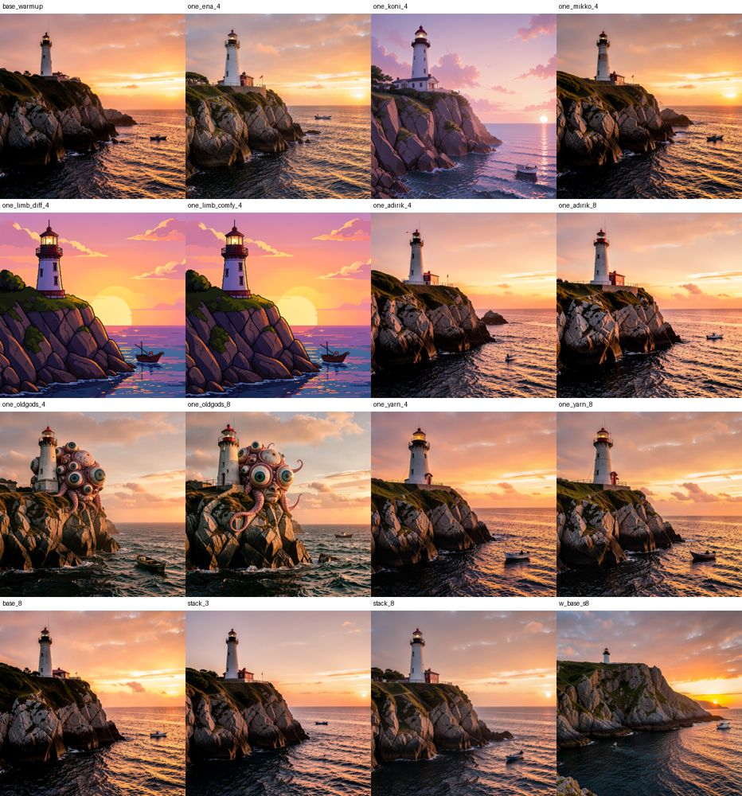
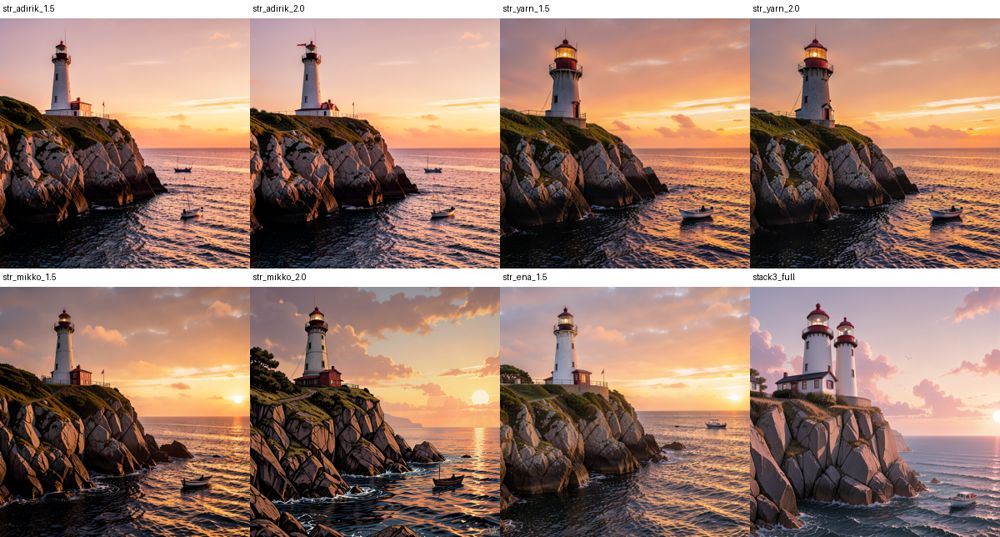
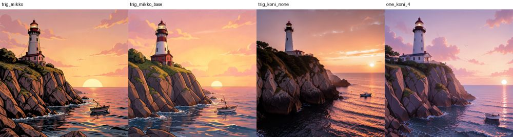

# Spike S0: styles (LoRAs) on our FLUX.2 klein 4B (ADR-0091)

- **Date:** 2026-10-29, on the owner's Mac (Apple silicon, 64 GB), ComfyUI 0.40.0 on MPS, the app's own install and model
  folders, the app's Create workflow (`flux2-klein-4b.json`: distilled klein 4B, 4 steps, cfg 1, 1024 x 1024) with a chain of
  `LoraLoaderModelOnly` nodes, as the `lora_chain` of the workflow map builds it.
- **What was used:** the style Train made on this Mac (`wasify-ena-b37ba287`) and 7 files from Hugging Face (1.5 GB, downloaded
  with the owner's go, deleted after), plus the headers only (a few KB each, no weights) of 5 more for the fingerprints.
  Scripts and outputs stayed outside the repo; the run log is `styles-s0/runs.jsonl`, the contact sheets are in `styles-s0/`.
- **Verdict: go**, with four changes to ADR-0091 (end of this page). The single most useful fact: **a style must have been
  trained on the distilled klein 4B (or be a subject/concept style) to show on our model; a look trained on klein base barely shows,
  even at strength 2 or 8 steps.** That includes the style our own Train makes today.

## (a) Which key formats ComfyUI applies

| Format (first key) | Example | Applied? |
|---|---|---|
| `diffusion_model.…lora_A/B` (ai-toolkit, our Train) | Koni anime, pixel art (adirik), old gods, yarn, ena | yes, every key |
| kohya `lora_unet_…lora_down/up` | mikkoani | yes, every key |
| diffusers `transformer.…lora_A/B` | Limbicnation pixel art | yes, but 6 of 172 keys skipped (`double_stream_modulation_*`, `single_stream_modulation`): ComfyUI logs "lora key not loaded"; the look still applies fully |
| no prefix (`double_stream_modulation_img…`, a "comfyui" export) | Limbicnation pixel art (comfyui file) | the same as diffusers: 6 keys skipped, look applies; the two files give the same picture |

**No converter is needed.** The importer may keep the file as it is. The 6 skipped modulation keys are worth one line in the
check ("a few parts of this style are not used by this app") rather than a refusal. No file had text-encoder keys.

## (b) The fingerprint, read from the header

| Model | Width (`lora_A` / `lora_down` input) | Double blocks | Single blocks | Seen in |
|---|---|---|---|---|
| **FLUX.2 klein 4B** (base or distilled) | **3072** | **5** | **20** | 8 files, every format (`transformer_blocks` 5 and `single_transformer_blocks` 20 in diffusers names) |
| FLUX.2 klein 9B | 4096 | 8 | 24 | DeverStyle `dever_arcane_f2k_9b` |
| FLUX.1 (dev and schnell) | 3072 | 19 | 38 | `alvdansen/frosting_lane_flux` (diffusers); XLabs' realism LoRA uses its own `double_blocks.N.processor` names and 19 blocks |

Rule: width 3072 with at most 5 double and 20 single block indices → **fits**; width 4096 or block indices above 4/19 → **made for
another model** (name it when the numbers match the 9B or FLUX.1 rows); anything without these block names → **not sure**.

**Base or distilled cannot be read from the file.** Both write `ss_base_model_version: flux2_klein_4b` (ai-toolkit) or
`Flux.2-klein-4b/lora` (kohya). Only our own Train writes `taught_on`, and the Hugging Face repo says it in its `base_model` tag
(`black-forest-labs/FLUX.2-klein-base-4B` or `.../FLUX.2-klein-4B`). That matters, see (d).

## (c) Time and memory (warm, 1024 x 1024, 4 steps)

| Run | Seconds | Peak memory of ComfyUI (RSS) |
|---|---|---|
| No style (3 seeds) | 11.9 to 12.8 | 9 to 14 GB |
| 1 style, first picture with it / the next | 12.5 / 11.3 | 13 GB |
| 3 styles, first / next | 12.8 / 11.0 | 13.4 GB |
| 8 styles, first / next | 14.9 / 11.3 | 13.6 GB |
| 8 steps, no style or one style | 23.8 to 24.8 | 15 GB |
| First picture after start (loads the models) | 27 | 20.6 GB |

**A style costs nothing per picture once applied; changing the set adds about 1 to 3 s to the next picture (the patch).** Memory
does not grow measurably with 8 styles (each file is 90 to 370 MB). Decision 7's line before Generate becomes "Changing styles adds a
few seconds to the next picture", not a per-style cost.

## (d) Base-trained styles on our distilled model

| Style | Trained on | At 4 steps, strength 1 | 8 steps | Strength 1.5 and 2 |
|---|---|---|---|---|
| Koni anime | distilled 4B (repo tag) | **clear** anime look | | |
| Pixel art (Limbicnation), both formats | distilled 4B | **clear** pixel art | | |
| Old gods (a subject: many-eyed creatures) | base 4B (the card says it works on both) | **clear** | clear | |
| mikkoani | distilled 4B (tag) | slight; most of the look comes from its trigger phrase, see (e) | | slight |
| Pixel art (adirik) | base 4B | **no visible change** | none | none |
| Yarn art | base 4B | **no visible change** | none | none |
| ena (our Train, `taught_on: flux2-klein-base-4b`) | base 4B | no visible change **with the wrong word** ("ena"); **corrected 2026-10-30:** with its real word, `gabrin`, the same woman in every scene (see below) | | |

A look learnt on klein base does not carry to the distilled model; more steps (8) and more strength (2.0) do not bring it out.
A subject learnt on base does. So guidance does **not** need to join the Advanced section (decision 10): no setting rescues these.

**Correction (2026-10-30): our own Train is not affected the way this page first said.** Ena was tested with the word "ena"; its
magic word is `gabrin`. With `gabrin`, at 4 steps and strength 1, every picture with Ena shows the same woman as its training
pictures (long dark wavy hair, the same face) in new scenes, and without Ena a different person each time (two seeds, two scenes;
pictures in `styles-s0/ena-with-its-word.jpg`). A **character** taught on klein base carries to the distilled model. What did
not carry were two **looks** (pixel art, yarn) others taught on base; whether a look Train teaches carries is not measured yet.

## (e) Where trigger words live

| Where | Example | Machine-readable? |
|---|---|---|
| `ss_tag_frequency` in the header (the dataset folder `N_word`) | `1_PXART4` → `PXART4`; `1_Y4RN_ART`; `1_anime_style`; `1_old-gods` | yes: the folder names after `N_` |
| `trigger` in the header | old gods: `[trigger]` (a placeholder) | yes, but ignore bracketed placeholders |
| `instance_prompt` in the repo card's front matter | old gods: `old-gods` | yes (S3 reads it with the file list) |
| The card's text or its widget prompts | Limbicnation: "pixel art sprite, …"; mikkoani: `@mikkoani illustration` | no: shown to the person to copy |
| Our Train | (the magic word, kept by Train) | yes, written to the sidecar |

The word matters: Koni without `anime_style` is close to no style at all; with it, the look is clear. **Use this word** (decision 8)
is therefore part of using a style, and a style with no known word should say so ("this style's word is not known; see its page").

## (f) The Recommended shortlist (klein 4B, checked here)

| Style | Repo and file | Size | SHA-256 | Word | Notes |
|---|---|---|---|---|---|
| Anime (Koni) | `Sawata97/flux2_4b_koni_animestyle` / `Flux_klein_4b_anime_Koni.safetensors` | 185 MB | `c5f8fef8610f8f7725ab4da0410ff6ffb09542e9a65676ebcf01527eb3af429f` | `anime_style` | distilled; strong |
| Pixel art sprites | `Limbicnation/pixel-art-lora` / `pytorch_lora_weights.comfyui.safetensors` | 325 MB | `24e938f510f5dd0c890ac8b1078f4abb87a50c9c053b2e85c44821c0f30011ad` | `pixel art sprite` | distilled; 6 keys unused, look intact |
| Old gods (creatures) | `Norod78/flux2-klein-4b-lora-old-gods` / `flux2-klein-4b-lora-old-gods.safetensors` | 92 MB | `0d028797b10e46e049cf2953bf14c486cbf511c336a6d99df7848979cf90f4bd` | `old-gods` | base, works on both (a subject) |

Three is enough for v1; more after people use it. Licences are not checked (owner, 2026-10-29).

## (g) Stacking

Eight styles at 0.5 each wash out to almost no style; three at 1.0 mix visibly (anime plus pixel plus creatures). The screen should
start a new row at 1.0 and say, when more than three are on, that "several styles blend and weaken each other".

## What changes in ADR-0091

1. **Decision 5:** no converter; keep the file as it is. Skipped keys are counted by the import check and said in one line.
2. **Decision 6 (fit):** the rule in (b). Add a fourth fact shown with the fit: **"Made for klein base: the look may not show on this
   model"** when the source says so (our Train's `taught_on`, the Hugging Face repo's `base_model` tag). It stays selectable.
3. **Decision 7:** the time line is "Changing styles adds a few seconds to the next picture"; no per-style cost.
4. **Decision 10:** guidance stays out of Advanced; nothing measured here needs it.

## For the owner (not blocking S1; superseded 2026-10-30, see the correction above)

Train's styles do not show in Create because Train teaches on klein base and Create runs the distilled model. Choices: (1) Train
teaches on the distilled 4B (ai-toolkit and others do this; mflux support to be checked); (2) Create runs klein base (about 4x slower,
it needs 20+ steps); (3) leave it and say so on the style ("made for klein base"). Recommended: (1), checked in a Train spike before S2's
"Use in Create".
