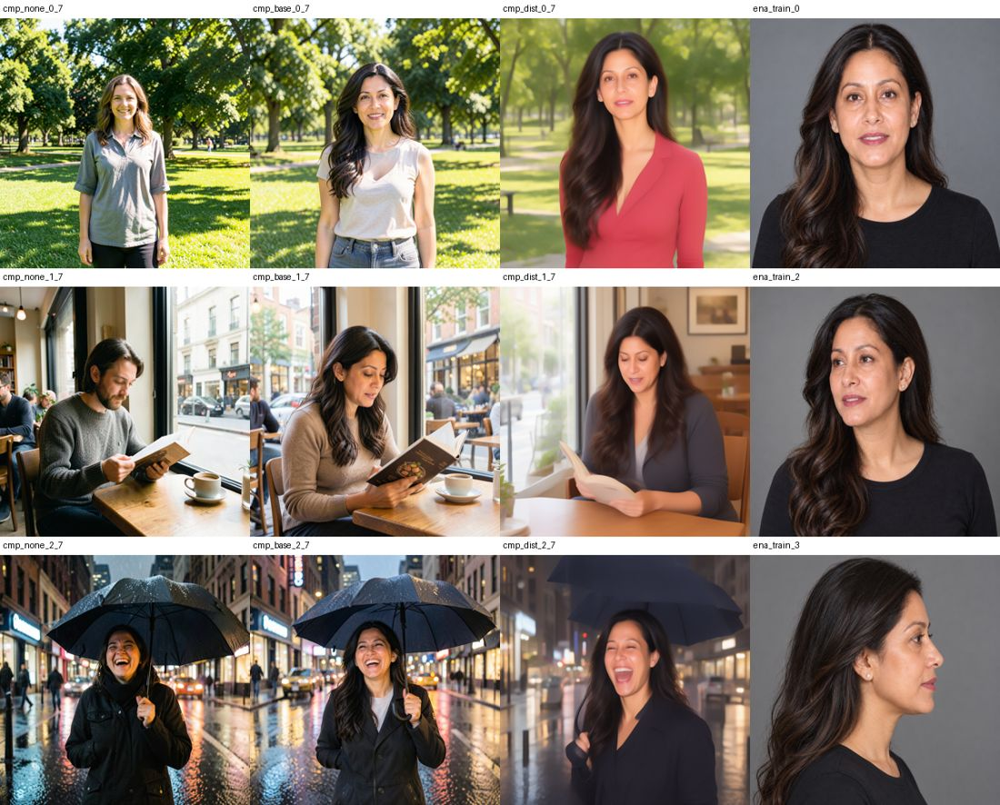
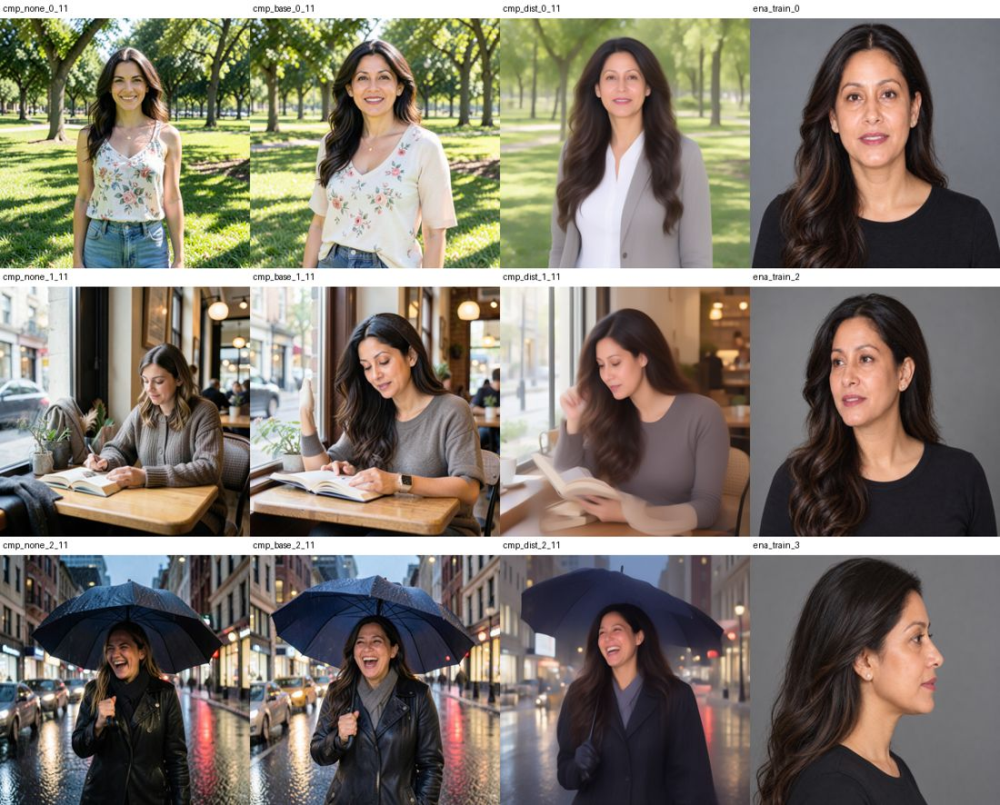

# Check: should Train teach on the distilled klein 4B? (2026-10-30)

**Asked by:** the owner (decision 1 of 2026-10-30), after spike S0 (`styles-s0.md`) said a style Train makes "barely shows" in
Create, because Train teaches on FLUX.2 klein **base** 4B and Create runs the **distilled** klein 4B.

**Answer: no. Train keeps teaching on klein base.** S0's finding about Train was wrong, and teaching on the distilled model makes
the pictures worse.

## 1. S0 used the wrong word

S0 prompted Train's style Ena with "ena". Ena is a character whose magic word is `gabrin`. With `gabrin`, at Create's 4 steps and
strength 1, every picture with Ena shows the same woman as her training pictures (long dark wavy hair, the same face) in new
scenes; without Ena, a different person each time (once a man). Corrected in `styles-s0.md`.

## 2. The same run on the distilled model

| | Base (Train today, run b37ba287) | Distilled (this check) |
|---|---|---|
| Model taught | `flux2-klein-base-4b` | `flux2-klein-4b` (mflux supports it: any FLUX.2 model gets the same training adapter) |
| Pictures, captions, word | Ena's 10 pictures, captions with `gabrin` first | the same |
| Settings | Train's: 200 steps, rank 16, 768 px, 8-bit, lr 1e-4 | the same; sampling guidance 1 |
| Time on the owner's Mac | 43 min (2,604 s) | 39 min (2,324 s; 7.7 to 11 s a step) |
| Adapter | 84 MB, 120 tensors | the same shape; converted with `comfy_lora.convert` |

What was needed on disk: only the distilled **transformer** (`black-forest-labs/FLUX.2-klein-4B` at commit `e7b7dc27`,
7.75 GB, SHA-256 checked). Its text encoder, tokenizer and VAE are the base repository's (same files; the configs differ only
in `is_distilled`), so they were linked, not fetched. Kept at
`<app data>/components/mflux/models/flux2-klein-4b` (owner's choice).

## 3. In Create (4 steps, strength 1, the word in every prompt)

Three scenes (a park, a café, a rainy street at night) at seeds 7 and 11: no style, the base-trained Ena, the distilled-trained
Ena, and a training picture.

- **Base-trained:** the picture keeps Create's sharp, detailed look and the same composition as without a style; the person
  becomes Ena.
- **Distilled-trained:** about the same likeness, perhaps a little closer in the face, but **every picture is softer**: blurred
  backgrounds, smeared hands (the café), a flat studio light. Training at these settings wears down what the distillation gives
  (sharp pictures in 4 steps). Making it work would need another recipe (fewer steps, an assistant adapter of the kind ai-toolkit
  uses for distilled models), which mflux does not offer for klein.

## What follows

- Train stays on klein base (ADR-0073 unchanged).
- A **character** taught on base carries to Create. Two **looks** others taught on base (S0) did not; whether a look *Train*
  teaches carries is not measured (no style dataset on this Mac yet). The Styles row's warning "made for klein base: the look may
  not show" is shown on Ena too, where it is not true; worth narrowing to looks.
- The distilled transformer (7.75 GB) is not needed by Train; it can be deleted.
